# M5Tab Rowing

A SpeedCoach-style rowing monitor for the M5Stack Tab5 (ESP32-P4). Stroke rate
comes from the built-in BMI270 accelerometer; split, distance and distance per
stroke come from a GPS unit on the Grove port; heart rate from any Bluetooth
chest strap or a Garmin watch broadcasting HR. The built-in camera looks toward
the bow, offline waterway maps sit on the microSD card, and every session is
logged there for on-device review or GPX/TCX export. Runs standalone.

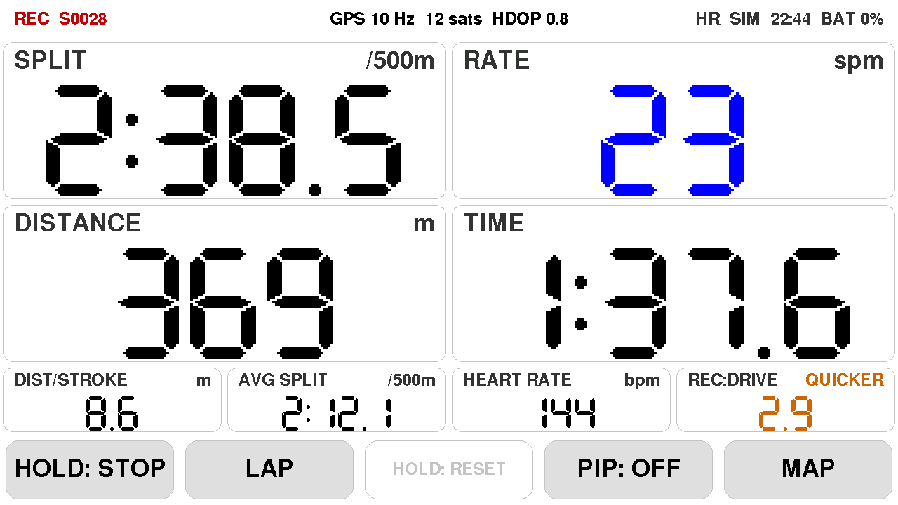

## Hardware

| Part | Notes |
| --- | --- |
| M5Stack Tab5 | 1280×720 display, BMI270 IMU, microSD, battery, camera, Bluetooth, 2.4 GHz Wi-Fi, battery-backed clock |
| M5Stack Unit GNSS / GPS v1.1 (ATGM336H-6N, AT6668) | plug into **Port A** (red Grove, G53/G54) |
| microSD card | FAT32 (exFAT is not supported); the `F`/`Y` serial command formats it on the device |
| Heart rate (optional) | BLE chest strap or a Garmin watch with Broadcast Heart Rate; ANT+ is not supported |
| Waterproof case / phone mount | the Tab5 is not water resistant |

The firmware switches the Grove 5 V output on and turns Port A into a UART. It
scans 115200/9600/38400/57600 baud and both pin orders, so the unit works with
a standard Grove cable. Once found it configures 10 Hz updates (AT6668 /
CASIC commands, with u-blox and MTK fallbacks) and only RMC + GGA sentences.

Mounting: any orientation works. The detector finds the boat's forward axis by
itself (largest horizontal acceleration) and works out which way is forward from
the shape of the stroke, or from GPS once you are moving above 1 m/s. Mount it
rigidly: a wobbly holder adds noise that looks like strokes. **Rotate screen 180**
in Settings if the case is mounted the other way up.

## Building and flashing

PlatformIO with the [pioarduino](https://github.com/pioarduino/platform-espressif32)
platform `55.03.312-1` (Arduino core 3.3.12, ESP-IDF 5.5) and the `m5stack-tab5-p4`
board, which targets the pre-rev3 ESP32-P4 silicon in current Tab5 units. The
camera library (`ESP_Video`) needs Arduino core 3.3.11 or later.

```powershell
$env:PYTHONIOENCODING='utf-8'; $env:PYTHONUTF8='1'   # esptool prints non-cp1252 characters
python -m platformio run -e tab5 -t upload --upload-port COM10
```

Environments:

- `tab5` is the real firmware.
- `tab5_sim` generates synthetic rowing (20 → 32 → 20 spm over 2 minutes, device
  tilted 35 degrees) and a synthetic GPS track, so the whole pipeline can be tested
  at a desk. The top bar shows a `SIM` badge.

Windows notes:

- `platformio.ini` sets `core_dir = C:/pio` because the ESP32 Arduino libraries
  nest deeper than Windows' 260-character path limit. Delete that line if long
  paths are enabled or you build on Linux/macOS.

## Using it

The right-most bottom button cycles seven screens. **Maps** is opened with **MAPS**
on the Map screen between sessions (Wi-Fi is only used there). **GPS diagnostics** opens from the GPS status in the centre of the top bar, or
from **OPEN** on Settings → Sensors. **TARGETS** and **SEGMENTS** on the map
open those lists. **BACK** returns to the screen you came from. Maps, GPS
diagnostics, the target list and the segment list are not part of the seven-screen cycle.

| Screen | Content |
| --- | --- |
| Main | eight metric tiles you can rearrange; optional camera or map picture-in-picture |
| Map | offline waterway map with your position, heading, track, targets and segments |
| Efficiency | metres per stroke against rate, efficiency score, rec:drive / check / bounce, coaching hint |
| Stroke | one stroke split into catch, drive, finish, run and approach, against acceleration and GPS speed, with one coaching hint |
| Plot | last 6 s of surge acceleration with catch, finish and threshold; IMU diagnostics |
| Settings | **STROKE**, **DISPLAY**, **SENSORS** and **WIFI** tabs |
| Sessions | recordings on the card: review, rename, delete |
| Maps | download a library water, draw an area, or manage maps on the card |

### Buttons and sessions

Bottom buttons: **START** starts a session, **LAP** splits a lap, **hold STOP**
(~0.8 s) ends it, **hold RESET** clears it (only while stopped). The fourth
button is **PIP** on Main, map orientation on Map, and **hold CLEAR** on
Efficiency. The fifth button is the next screen.

Stroke rate and split run before START. Distance, time, averages, the GPS track
and logging run only during a session. Without a card the session still runs on
screen (`RUNNING (no SD)`); the Plot screen says it is not recording.

A **LAP** press freezes the previous piece in a banner for a few seconds (time,
distance, average split and rate, and average heart rate if you have a sensor).
Laps are stored in `_laps.csv` and become laps in the TCX export.

### Top bar

- **Left:** `READY`, `REC S####` while recording, `STOPPED`, or `RUNNING (no SD)`.
- **Centre:** GPS (`not connected` / `GPS on, searching` until it sees satellites,
  then `searching N sats` / `GPS n Hz n sats HDOP …` once it has a fix), a lap
  banner, or a short hint (for example after pairing). Tap this status to open
  GPS diagnostics. Settings → Sensors has the same **OPEN** button.
- **Right:** heart-rate state (`HR`, `HR...`, `NO HR`), `WIFI` / `WIFI...` on the
  Maps screen, `SIM` on a simulation build, local clock, battery (`BAT n%`,
  or `USB` when the Tab5 is on USB power with no pack attached).

Dates and times on screen are local (`cfg::TIMEZONE`, Amsterdam by default). Log
files are UTC. The battery-backed clock is set from internet time whenever Wi-Fi
is connected and from the GPS once it has a fix, and keeps time while the Tab5
is off.

### GPS

Tap the centre of the top bar, or **OPEN** on the GPS row in Settings → Sensors.
The page is the same tile layout as the main screen.

| Tile | Shows |
| --- | --- |
| GPS | `FIX`, `SEARCHING`, `SCANNING` or `NO LINK`. The corner is the Grove pin and baud |
| SATELLITES | satellites used |
| HDOP | horizontal accuracy. A fix needs HDOP at or below 4, and at least 4 satellites |
| SPEED | m/s, once there is a fix |
| COURSE | degrees |
| TIME | GPS time of day, UTC |
| SIGNAL | update rate. The corner says `bad` if checksums are failing |
| POSITION | last accepted latitude and longitude |

Indoors the module can be powered and talking (`GPS on, searching`, 0 satellites,
HDOP 25.5) while the fix LED stays dark. That LED blinks only once the receiver
has a lock. Put the unit by a window or outside; a fix needs a clear view of the sky.

### Main screen

Eight tiles. Tap the right half of a tile for the next metric, the left half
for the previous; the layout is remembered. The
same eight slots are used in every layout, so the four big Main tiles are the
same four as the strip above the Map and full-width PIP. Duplicates are allowed.

Default layout: split, rate, distance, time on top; dist/stroke, avg split,
heart rate, rec:drive below.

| Tile | Unit | Notes |
| --- | --- | --- |
| SPLIT | /500m | GPS speed of the last stroke; live before START |
| RATE | spm | IMU, average of the last 3 strokes; live before START |
| DISTANCE | m | this session |
| TIME | | this session |
| DIST/STROKE | m (`m*` with fusion on) | last stroke |
| AVG SPLIT | /500m | this session |
| AVG RATE | spm | this session |
| STROKES | | this session |
| HEART RATE | bpm | orange `--` while there is no reading |
| AVG HR | bpm | this session |
| REC:DRIVE | SLOWER / GOOD / QUICKER | recovery ÷ drive, see below |
| SPEED | m/s | GPS speed over ground |
| DTT | target or segment name | metres to the selected target. With a segment this is **DTS** (to the start line) until the boat crosses it, then **DTF** (still left along the points). `--` until one is selected and a position is known |
| TTT | target or segment name | that distance at the current speed (**TTS** / **TTF** for a segment). `--` when nearly stopped |
| FINISH | target or segment name | that distance at the session average split. Before a segment's start line the label is **START**. `--` until the session has an average |

**PIP** cycles the picture-in-picture pane through **OFF**, **CAMERA** and
**MAP**. Tap the pane (not a metric tile) to switch between picture-in-picture
(pane top left, first two tiles big beside it) and full width (first four tiles
in a strip above it).

- **CAMERA** shows the built-in camera, which looks past the rower towards the
  bow. It runs only while shown, at about 20 fps, and stops on the other screens.
  The image is mirrored by default, like a rear-view mirror; turn that off in
  Settings. Flip display also flips the image so it stays upright.
- **MAP** shows the same offline waterway map as the Map screen. The PIP map
  always follows the boat; pan and locate are for the full map.

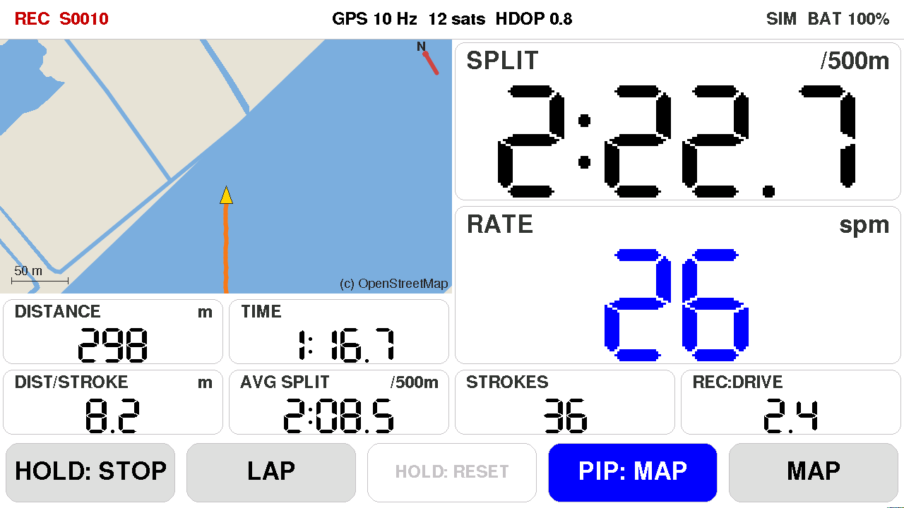

### Heart rate

Any Bluetooth heart rate sensor works: a chest strap (Polar H10, Garmin HRM,
Wahoo TICKR, ...) or a Garmin watch with **Broadcast Heart Rate** switched on
(controls menu, or "broadcast during activity" in the sensor settings), so you
can keep recording on the watch too.

In Settings, tap **PAIR** on the heart rate row while the sensor is on and
close by; the strongest one in range is saved. The Tab5 reconnects to it by
itself at every start and whenever it drops out. **FORGET** removes it, after
which you can pair another. A hint at the top confirms the name, or that none
was found.

Heart rate is a tile you can put anywhere (it starts in the bottom row). The
top bar shows `HR`, `HR...` (connecting) or `NO HR`. The lap banner and session
review add average and maximum heart rate.

A chest strap reads much more reliably than a watch while rowing: grip tension
and wrist flexion make optical wrist readings lag or drop out at high rates.

### Map screen

The Map screen draws an offline vector map of the waterways around you, built
from OpenStreetMap data (see [Offline maps](#offline-maps)). Water areas and
canals are blue, bridges grey, locks and clubs red, weirs brown, piers grey.
Your boat is the yellow triangle; the current session's track trails behind it
in orange. Night theme uses a dark map (dark land, deeper water, light labels)
so it does not glare; day theme is the paper map. The scale bar is bottom-left
and the OpenStreetMap credit bottom-right. A red north arrow shows unless north
is already up.

- The **HEAD UP** / **BOW UP** / **NORTH UP** control cycles what is at the top
  of the map: the direction the rower looks (stern), the direction of travel
  (bow), or north. During a session it is an icon the same size as the zoom
  buttons (boat head-up, boat bow-up, or a compass for north-up); otherwise it
  is the fourth button under the map.
- The **+** / **−** buttons bottom-right zoom in and out (100 m to 3.2 km
  across the view). During a session they are double size so they are easier to
  hit.
- Drag the map to look ahead. A locate button appears to the left of **−**
  while the map is not following the boat; tap it to centre back on your
  position. Leaving the Map screen, leaving full-width PIP, or tapping locate
  resumes follow. Opening the target or segment list does not.
- **Hold** a point on the map to drop a target there. On a named map it is
  saved as `Map name - T1`; otherwise just `T1`. It is selected immediately and
  drawn with a line from the boat. **TARGETS** opens the list: tap a row to
  select it (tap again to clear), **RENAME** changes the name, **DELETE**
  asks for a second tap before it removes it. The **DTT**, **TTT** and **FINISH** tiles follow the selected target.
- **SEGMENTS** joins points into a course. **NEW** opens the map: tap to drop
  each point and it is connected to the one before. The first is the start,
  the last is the finish, and any in between are via points. Tap an existing
  target to use that one. Drag a point to move it. **UNDO** removes the last
  point, **SAVE** keeps the course; leaving the map discards the new points.
  On a named map the segment is saved as `Map name - S1`. The distance is the
  path along those points, not the straight line from start to finish.
  Within 100 m of a start, that segment's name appears on the map. Tap it to
  select the segment: the course is drawn and the distance tiles count down to
  the start line (**DTS**). Selecting a segment draws that path and its name on the map, and a start line
  through the start pin, square to the first leg and 40 m to each side. The
  points stay put while you look. **EDIT** on the map arms them: drag a point
  to reposition it (a point shared with another segment moves there too). Before
  the boat crosses the start line the distance tiles count down to it (**DTS**).
  Afterwards they follow what is left along the points (**DTF**). A finish line
  crosses the last pin, square to the last leg, the same 40 m to each side, drawn
  in red. Crossing the start line in the direction of the course, with the boat
  actually moving, starts the piece. Crossing the finish line the same way stops
  it and shows the time, distance, split, rate, strokes and heart rate. **DONE**
  closes that. The piece is saved as a race session named after the segment.
  In the list those actions are large icons, the same size as on Settings: a
  course to **EDIT** which targets are included and their order, two pages to
  **COPY** the same course or the points in opposite order, a pencil to
  **RENAME**, and a trash can for **DELETE**, which asks for a second tap
  before it removes the segment.
  Deleting a target drops it from
  every segment.

The map follows your GPS fix and automatically switches to whichever uploaded
map file covers your position (up to 24 `.rmap` files on the card). Between
sessions, **MAPS** on the map opens the download screen. **ON CARD** there,
tap a map to show that one instead: it stays on screen, centred, so you can
drop targets and build segments on it. The locate button returns to following
the boat, and to whichever map covers your position.

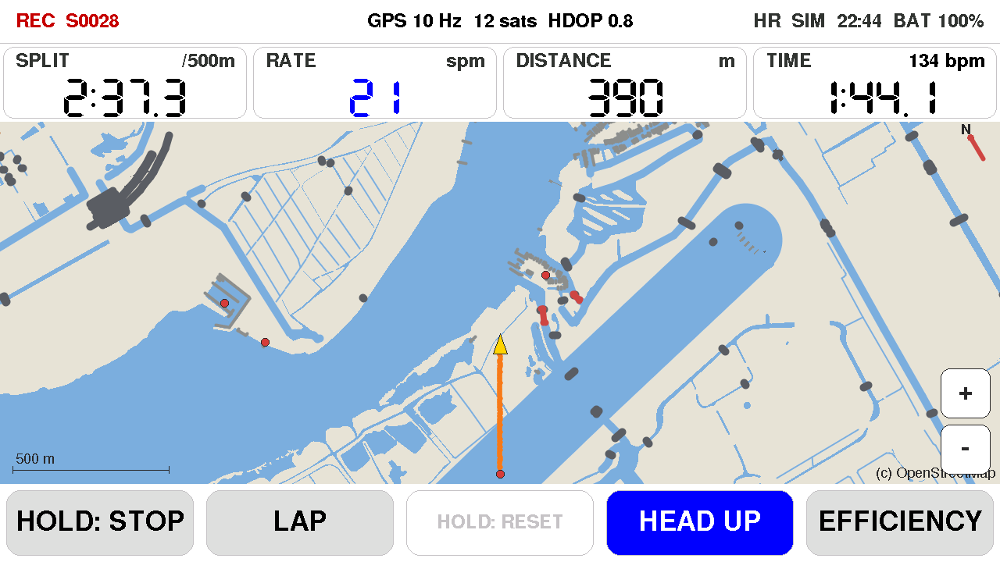

### Rhythm and efficiency

**REC:DRIVE** is recovery time divided by drive time, averaged over 5 strokes.
The target follows the stroke rate: about 2.5 at 20 spm, falling to about 1.3
at 34 spm (a long, calm recovery at low rates; at race pace the recovery has to
shrink). Within 15% of the target the tile is green with **GOOD**; below it,
orange **SLOWER** means you are rushing the slide; above it, **QUICKER** means
the recovery drags. Red means more than 30% off. If your coach wants a
different rhythm, shift the whole target up or down in Settings (−0.8 to +0.8).

The **Efficiency** screen compares each stroke with your own best in this
session at the same rate:

- The chart plots metres per stroke against stroke rate. The blue line is your
  best (3-stroke average, so a single GPS jump does not count), the big dot is
  now. The thin curves are lines of equal split: getting the same split at a
  lower rate means longer strokes, so aim to push your best line up and right.
- **EFFICIENCY** is your current distance per stroke as a percentage of that best
  (it needs about 5 strokes at a rate before it scores).
- The gauges show recovery:drive against its target band, and check and bounce
  against your usual values in this session (lower is better).
- The line above the buttons gives one hint, in order of priority: rhythm,
  then a rough slide (check), then stroke length.

Wind and current change distance per stroke, so the best line is per session:
it clears when you start a new session, and **hold CLEAR** clears it after you
turn into the wind. **EN** or **NL** at the top right of the panel switches the
coaching text on this screen and on Stroke. It stays until you tap it again.

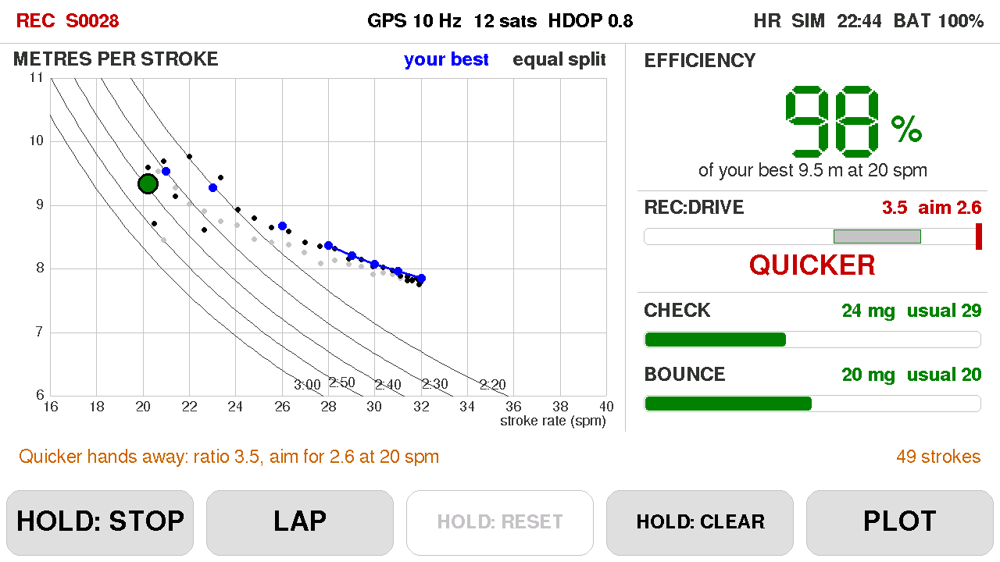
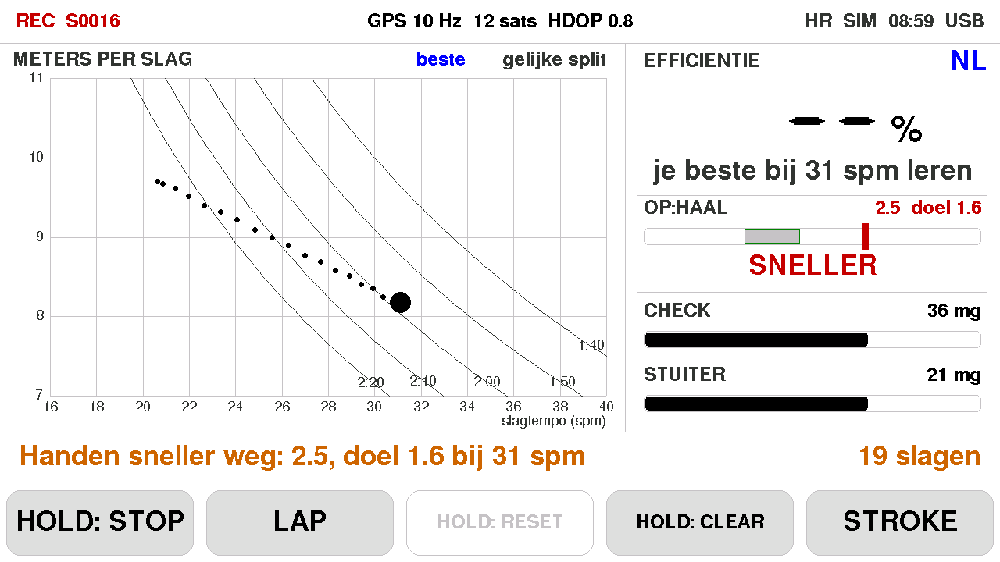

### Stroke screen

The **Stroke** screen splits the stroke you are rowing into five phases and compares the last few strokes with your own best at the same rate.

The chart is one stroke, from just before the catch to the next one. The top line is the hull acceleration, averaged over the last five strokes, with your reference stroke drawn behind it. The bottom line is the speed through the stroke, built from that acceleration and set to the GPS speed of the stroke; the GPS speed itself is the dots, so the two can be read against each other. A green line marks the catch and a cyan line the finish, as on the Plot screen.

The shaded bands are the phases:

- **Catch.** The dip as the blade goes in: how long it lasts, how deep it is, and how much speed it costs.
- **Drive.** The push: the speed it adds, and whether the peak comes early or late.
- **Finish.** The release: how fast the push dies away, and any dip as the blade comes out.
- **Run.** The glide: how hard the boat is slowing, and when the speed peaks.
- **Approach.** The run-in to the next catch: how long before the catch the boat starts to slow.

The line above the buttons gives the one most useful hint. In order: catch together, dip later, a quicker catch, push harder, build the drive earlier or hold it through, then a cleaner release. With nothing to correct it says the stroke matches your reference.

**CREW** sets the boat to 1, 2, 4 or 8. With one rower a wide catch is worded as your own entry, because a single sensor on the hull cannot tell a slow blade from rowers out of time. With more than one it is worded as catching and finishing together: it can say the crew is not together, not which seat. **Hold** the button to clear the reference, as on Efficiency.

The reference is this session only. A stroke counts as one of your best when its distance per stroke is within 5% of your best at that rate on the Efficiency screen; until then the comparison is your usual stroke at that rate. It clears when a new session starts.

**EN** or **NL** at the top right of the panel is the same switch as on Efficiency. Dutch uses the words a crew hears on the water: inpik, haal, uitpik, oprijden. The screen font has no accents. Another language is a column in `src/i18n.cpp`.

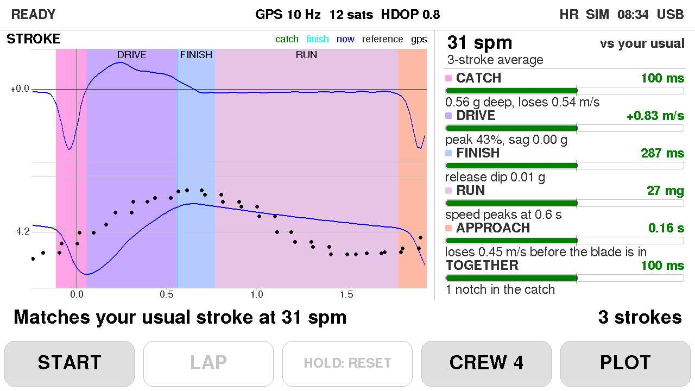
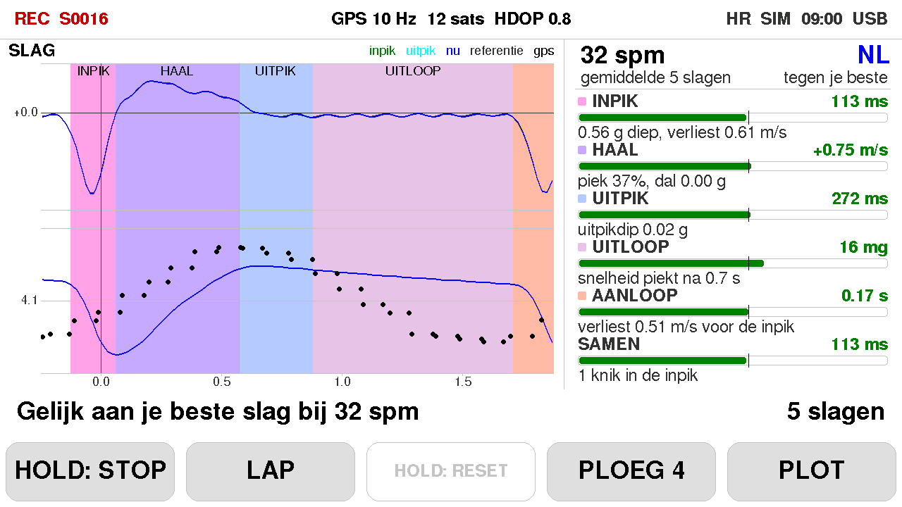

### Plot screen

The last 6 seconds of forward acceleration (surge), with the adaptive catch
threshold in red, a green line at each catch and a cyan tick at each finish.
Use it to see whether the detector is catching real strokes or bouncing on
chop.

Two rows under the chart show IMU sample rate and overruns, the learned axis
and sign, RMS and threshold, skew, live rate, stroke count, check and bounce,
GPS speed, fused speed (or `(off)`), and log drops. While a session records it
says `REC S####` and `raw IMU 100 Hz` if raw logging is on; without a card it
warns that nothing is being written.

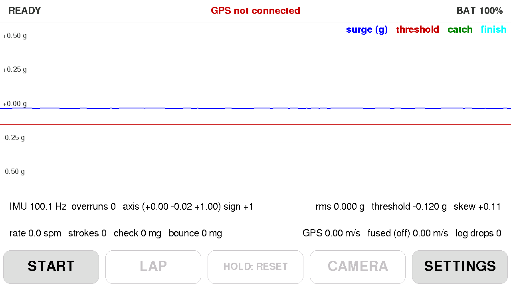

### Settings

Four tabs. Values are kept in flash.

**STROKE**

- Catch threshold factor (× RMS), default 1.8. Lower if strokes are missed.
- Catch threshold floor (g), default 0.12. A minimum even when the boat is quiet.
- Threshold from last 5 catch depths: follow your recent catch size instead of
  a fixed multiple of RMS. Helps in rough water (fewer double counts).
- Rec:drive target shift. Added to the rate-based target (2.5 at 20 spm).

**DISPLAY**

- Theme: day (light, paper map) or night (dark UI and dark map).
- Brightness.
- Rotate screen 180, for a case mounted the other way up (camera image follows).
- Camera mirror image (on by default).

**SENSORS**

- Heart rate sensor: **PAIR** / **FORGET**, see above.
- GPS+IMU fusion for distance/stroke: complementary filter (high-passed IMU
  speed + low-passed GPS). When on, the dist/stroke tile shows `m*` instead of
  `m`.
- Raw IMU logging at 100 Hz, on by default. About 13 MB per hour; needed for
  `analyse.py` / `replay.py`.
- GPS: **OPEN** shows the same tiles as the GPS page. The row shows
  `SEARCHING`, `FIX`, `SCANNING` or `NO LINK`.

**WIFI**

The saved network, or **No network saved**. **FORGET** drops it. Below that,
the access points in range (2.4 GHz), strongest first, with signal level and
`open` or `lock`. Tap a locked network and type the password on the on-screen
keyboard (**SYM** for symbols). Tap the saved network to join it again without
retyping. **RESCAN** looks again. The top bar shows `WIFI` once it is connected.
Wi-Fi still turns off when you leave Settings, except while the Maps screen is
open.

The footer shows whether the SD card is present, how many log lines were
dropped, and `build: hardware` or `build: SIMULATION`.

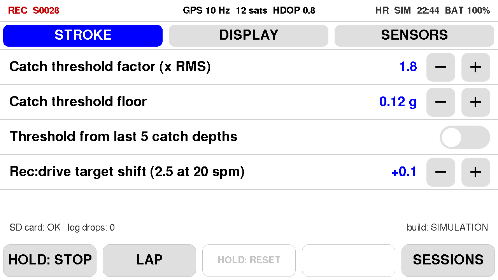

### Sessions screen

Lists every session on the card with its number, start date and time, duration
and size. A race finished on a segment is named after it, for example
`Tromp - S2 race`. The header reminds you of `python tools\fetch.py COM10` to copy them
off.

- The pencil gives a session a name such as `Bosbaan intervals` (on-screen
  keyboard). Its files become `S0022_Bosbaan_intervals_imu.csv` and so on, and
  `fetch.py` and `analyse.py` understand both forms.
- Tap a session's name to review it: the GPS track on the offline map, coloured
  from red (slow) to green (fast) with a start dot and a finish square, plus
  distance, time, average split, fastest 500 m, average rate, strokes, distance
  per stroke, top speed, average and maximum heart rate, and graphs of split,
  rate and heart rate over the session. Drag the map to pan, +/− to zoom, tap
  the map to fit the whole track again; **BACK** returns to the list. The track
  is drawn without a map when no map on the card covers it.
- A session without a GPS fix still shows what was recorded: time, average
  rate, strokes, laps, average and maximum heart rate, and the rate and heart
  rate graphs.
- The trash can, tapped twice (it turns red after the first tap), removes all
  files of a session.

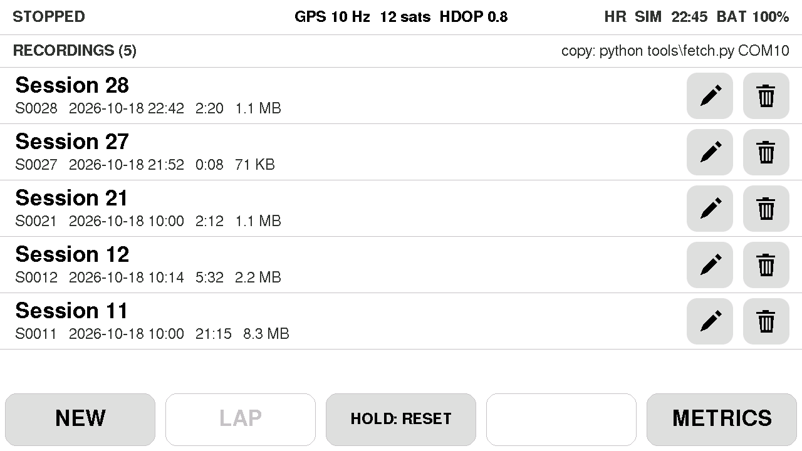
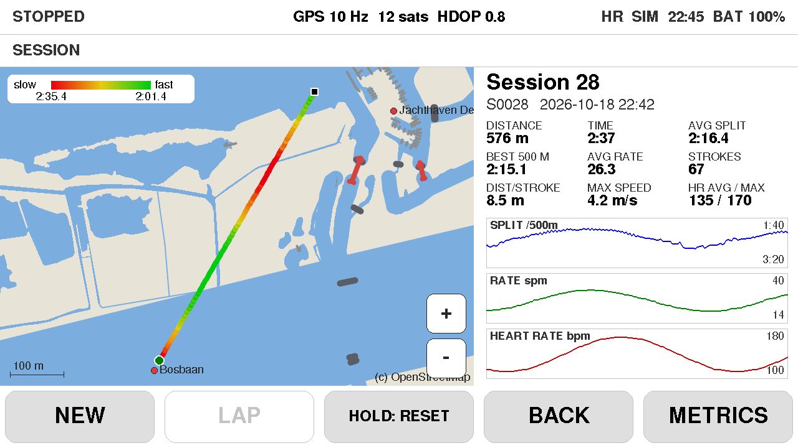

## Session logs

Each session writes `/rowing/S####_*.csv` on the SD card:

| File | One row per | Contents |
| --- | --- | --- |
| `_strokes.csv` | stroke | rate, drive/recovery time, split, speed, distance per stroke, distance, catch depth, check, bounce, position, catch time (`t_s`) |
| `_seconds.csv` | second | UTC, position, speed, split, distance, rate, HDOP, satellites, battery, heart rate (empty without a sensor) |
| `_laps.csv` | lap | lap time, distance, average split and rate, strokes, average and maximum heart rate |
| `_info.csv` | setting | build, start time, and the detector settings in use, so a session can be replayed exactly |
| `_imu.csv` | IMU sample (100 Hz) | raw accelerometer and gyro, filtered and unfiltered surge, vertical, threshold, catch / finish flags, GPS speed (only with raw logging on) |

`t_s` is the same clock in every file, so strokes and IMU samples line up.
`_info.csv` records where the session time came from (`time_source`: NTP, GPS
or RTC).

## Exporting to Strava or Garmin Connect

Fetch the session (or copy it with a card reader), then write GPX and TCX files
next to it:

```powershell
python tools\fetch.py COM10 latest
python tools\export.py 21                    # recordings\S0021.gpx and S0021.tcx
python tools\export.py all --format gpx --out exports
```

- **GPX**: track, time, speed, stroke rate (as cadence) and heart rate, marked as rowing.
  Strava recognises the type; upload it at strava.com/upload/select.
- **TCX**: also distance and one lap per **LAP** press. TCX has no rowing sport,
  so pick rowing after uploading.

Seconds without a GPS fix are left out of the GPX track.

## Recording strokes for detector tuning

1. Check **Raw IMU logging** is ON in Settings (it is by default) and press **START**.
2. The **Plot** screen says `REC S####` while it records.
3. Row a mix: steady state, rate changes, starts, easy paddling, rough water,
   stopping and restarting. Row at least a few minutes so the detector has
   settled, and keep the Tab5 firmly mounted: tilting it mixes gravity into the
   signal.
4. **Hold STOP** when done. Name the session on the **Sessions** screen if you
   like. Then copy the files with a card reader (`/rowing/` on the card), or over
   USB:

   ```powershell
   python tools\fetch.py COM10                 # list the sessions on the card
   python tools\fetch.py COM10 latest          # download the newest into recordings\
   python tools\fetch.py COM10 7 9             # or specific sessions; 'all' for everything
   ```

   About 550 KB/s, so an hour of rowing downloads in under half a minute. Files
   already in `recordings\` are skipped. Stop the session first: downloads are
   refused while it is recording.
5. Analyse a session (needs `pip install numpy matplotlib`):

   ```powershell
   python tools\analyse.py recordings\S0007
   python tools\analyse.py recordings\S0007 --replay --k 2.0 --floor 0.10
   ```

   This writes `recordings\S0007_analysis\` with a `summary.txt`, an overview
   (rate, stroke interval and GPS speed over the session), all strokes overlaid at
   the catch with the average stroke shape per rate band, the detector's view of
   the whole session one minute per page, and a close-up around every suspicious
   stroke (an interval far from its neighbours: probably a missed catch or a
   double count). `--replay` also runs the offline
   detector from `replay.py`, with the session's settings or the ones you give,
   and shows its catches as orange triangles, so you can see whether other
   settings fix a problem.

## Serial tools

Open the port with DTR/RTS held low; otherwise opening it resets the ESP32-P4.
The scripts in `tools/` do this.

| Command | What it does |
| --- | --- |
| `N` | next screen |
| `M` | open Maps (refused while recording) |
| `C` | cycle PIP off / camera / map (Main) |
| `V` | picture-in-picture ↔ full width |
| `H` | cycle map head-up / bow-up / north-up |
| `+` / `-` | zoom the map |
| `G` / `X` / `L` / `R` | start / stop / lap / reset |
| `g` | open GPS diagnostics (`N` or BACK returns) |
| `t` | open the target list (`N` or BACK returns) |
| `s` | open the segment list (`N` or BACK returns) |
| `h` | pair the strongest heart rate sensor in range |
| `S` | screenshot (RGB565; use `screenshot.py`) |
| `D` | list `/rowing` session files and `/map` files |
| `B path` | download a file (`fetch.py`) |
| `U path size crc` | upload a file (`send_file.py`) |
| `W SSID\|PASSWORD` | join Wi-Fi and remember it; `W ` reconnects |
| `T x y` / `P x y` / `Z x0 y0 x1 y1` | tap / hold / drag |
| `F` then `Y` within 10 s | erase the SD card (one FAT32 partition) and restart |

```powershell
python tools\serial_log.py COM10 60                       # print status every 5 s and every stroke
python tools\serial_log.py COM10 60 log.txt --send "3:G,40:L,70:X"   # start, lap, stop at those seconds
python tools\send.py COM10 N
python tools\send.py COM10 C
python tools\send.py COM10 H
python tools\send.py COM10 M
python tools\send.py COM10 h
python tools\send.py COM10 'T 640 360'
python tools\send.py COM10 'W MyNetwork|MyPassword'       # single quotes in PowerShell
python tools\serial_log.py COM10 5 --send "1:D"
python tools\serial_log.py COM10 40 --send "1:F,2:Y"      # format the card
python tools\fetch.py COM10 latest
python tools\export.py 21
python tools\screenshot.py COM10 shots\main.png           # needs Pillow
```

Status lines on the serial port report IMU rate and overruns, GPS, heart rate,
camera fps, loaded map, track points, heap and PSRAM, uptime and reset reason.

## Offline maps

Maps are vector `.rmap` files drawn on the device, not raster tiles, so they are
small and fast (a 6 × 6 km city area is about 300 KB). On the water no network is
needed: the map that contains your GPS position is loaded automatically.

### Downloading maps on the Tab5

Tap **MAPS** on the Map screen (between sessions). Wi-Fi switches on while this
screen is open and off again when you leave it. 2.4 GHz only.

- **LIBRARY**: well-known rowing waters. Tap the download arrow; for a map
  already on the card, the circular arrow fetches a fresh copy.

  Netherlands: Bosbaan, Amstel, Willem-Alexander Baan, Kralingse Plas, Delftse
  Schie, Galgewater / Oude Rijn, Zegerplas, Reeuwijkse Plassen, Vinkeveense
  Plassen, Spaarne, Vecht, Beatrixkanaal, Paterswoldsemeer, IJssel, Maas.
  Belgium: Watersportbaan (Gent). Germany: Regattabahn Wedau, Beetzsee.
  UK: Dorney Lake, Henley Reach, Tideway. Switzerland: Rotsee. Slovenia: Lake Bled.

- **DRAW AREA**: an OpenStreetMap background centred on your position (or on a
  map you already have). Drag to pan, +/− to zoom, tap **SELECT AREA** and drag
  a rectangle over the water you row on (up to 8 × 8 km), then **DOWNLOAD AREA**.
  Boxes already on the card are shown so you can see coverage.
- **ON CARD**: the maps on the SD card with their size. Tap a row to make that
  map the one on screen. It stays there, centred, until you tap locate on the
  map, so a fix on another water does not switch it away while you place
  targets. The one currently shown is marked. A map you drew is named after its
  centre (`Area 52.226 5.072`); tap the pencil to give it a proper name with
  the on-screen keyboard. The file name on the card stays the same. The trash
  can, tapped twice, removes a map.

A download takes 30–60 s, mostly waiting for the Overpass map server; the header
shows progress. The Tab5 then converts the data itself (about 2 s) and shows the
new map. Downloads are refused while a session is recording. If the server is
busy, try again a minute later.

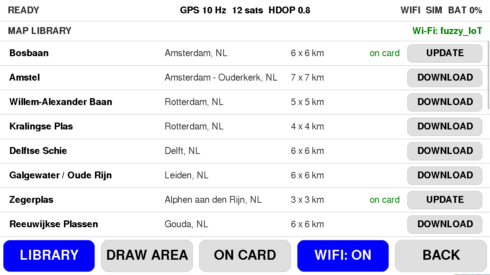
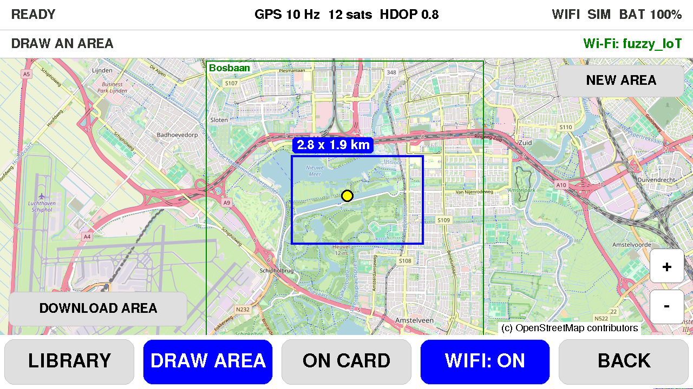
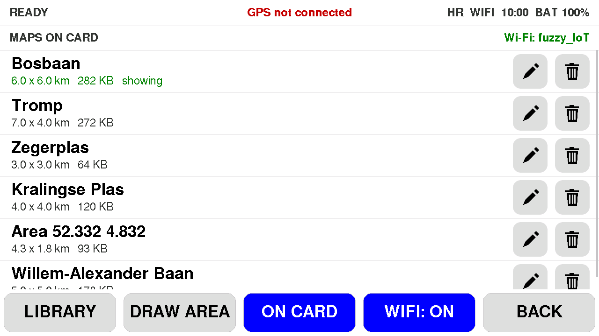

**Wi-Fi setup.** On **Settings → WIFI**, pick a network from the list. The same
setup still works from the Maps screen: the first time, tap **WIFI SETUP**
(later: hold the WIFI button to choose another network). The Tab5 opens its own
network `TabRowing-XXXX` and shows a QR code; scan it with your phone, or join
that network and open http://192.168.4.1, then pick your home network (2.4 GHz)
and enter its password. The Tab5 remembers it. Tap **CANCEL SETUP** to leave
without changing it. Over USB you can also send
`python tools\send.py COM10 'W MyNetwork|MyPassword'` (single quotes in PowerShell).

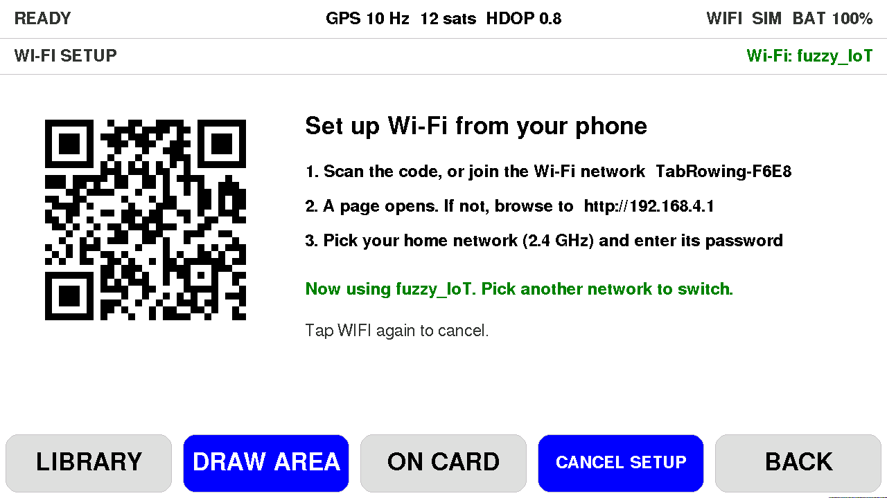

Map data is fetched over plain HTTP from overpass-api.de (that server only
accepts TLS 1.3, which the ESP32 TLS stack in this core does not support); the
background map uses HTTPS from tile.openstreetmap.org without certificate
checks. Only public map data is transferred.

### Building maps on a PC

Alternatively build a map with `make_map.py`
(needs `requests`, `osm2geojson`, `shapely` and `pillow`), then upload it to the card.

```powershell
pip install requests osm2geojson shapely pillow
python tools\make_map.py --center 52.3245,4.8360 --radius-km 3 --name "Bosbaan" --out maps\bosbaan.rmap
python tools\send_file.py COM10 maps\bosbaan.rmap /map/bosbaan.rmap
```

`make_map.py` queries the Overpass API for water, bridges, locks, weirs, piers
and rowing clubs, clips and simplifies them, and writes the `.rmap` plus a
`.png` preview so you can check it before uploading. `--bbox south,west,north,east`
is an alternative to `--center` / `--radius-km`. `send_file.py` streams the
file to `/map/` on the SD card in small acked chunks and verifies a CRC; the
firmware picks up the new map without a reboot. Uploads are refused while a
session is recording. Map data is
(c) OpenStreetMap contributors, [ODbL](https://www.openstreetmap.org/copyright).

## On-water validation against an NK SpeedCoach

1. Mount the Tab5 next to the SpeedCoach. Check **Raw IMU logging** is ON in Settings.
2. Start both at roughly the same time. Row a mix: steady state at 18–22 spm,
   a few minutes at 24–28, some starts and bursts at 30+, and some easy paddling.
3. Export the session from NK LiNK Logbook as CSV and copy the SD card files.
4. Compare per stroke. The time offset between the devices is found automatically:

   ```powershell
   python tools\compare_nk.py S0007_strokes.csv nk_export.csv
   ```

   It reports bias, mean absolute error and the 95% range for stroke rate,
   split and distance per stroke, the total distance, and lists strokes whose
   rate differs by 2 spm or more.

5. If strokes are missed or doubled, replay the raw log with other settings and
   copy the best values to the Settings screen:

   ```powershell
   python tools\replay.py S0007_imu.csv --sweep            # grid of K / floor / minima
   python tools\replay.py S0007_imu.csv --k 1.2 --floor 0.08
   python tools\replay.py S0007_imu.csv --plot 60 90       # needs matplotlib
   python tools\replay.py --synthetic 120                  # self-test on simulated rowing
   ```

   `replay.py` is a line-by-line port of `src/stroke_detector.cpp`; keep them in
   sync when changing the detector.

Tuning hints:

- **Missed strokes** (smooth or shallow catches, fixed-seat rowing): lower the
  floor to 0.08 g and K to about 1.2.
- **Double counts** (rough water, a big bounce at the finish): raise K, or turn on
  the minima threshold, which follows the depth of your recent catches.
- Drive and recovery look swapped on the Plot screen during the first strokes
  without GPS: the forward direction is still being learned from the stroke shape.
  It settles within a few strokes, and GPS overrides it after about 10 s of rowing.

## How it works

- **Stroke rate**: gravity is tracked with a slow average and removed. The
  remaining acceleration is band-passed (0.1–3 Hz) and projected onto the
  horizontal axis with the most motion. The catch is the sharp deceleration dip:
  a catch is the midpoint of where the signal crosses an adaptive threshold
  (K × RMS, or 0.6 × recent catch depth) on the way down and up again. Rate is
  the average of the last 3 stroke intervals. Strokes more than 6 s apart are a
  pause, not a slow stroke.
- **Forward direction**: the catch dip is short and deep, the drive is long and
  shallow, so the forward acceleration has negative skew. When GPS is moving, the
  integrated acceleration is correlated with the GPS speed fluctuations, which
  settles the direction even for smooth rowers.
- **Split and distance per stroke**: GPS speed averaged over each stroke cycle;
  distance accumulates GPS positions with a 3 m minimum step so it does not drift
  while stationary. Optionally a complementary filter blends GPS speed with the
  integrated accelerometer for distance per stroke (the `m*` tile).
- **Check / bounce**: check is how unevenly the boat decelerates during the
  recovery (scatter around a straight line, in mg); bounce is the vertical
  acceleration RMS.
- **Map drawing**: a full map frame is rendered on the other CPU core so the
  timer and metrics keep updating at 20 Hz while the map refreshes about five
  times a second.
- **Clock**: logs are UTC; the screen shows local time. NTP when Wi-Fi is up,
  GPS time once there is a fix, RTC in between.
