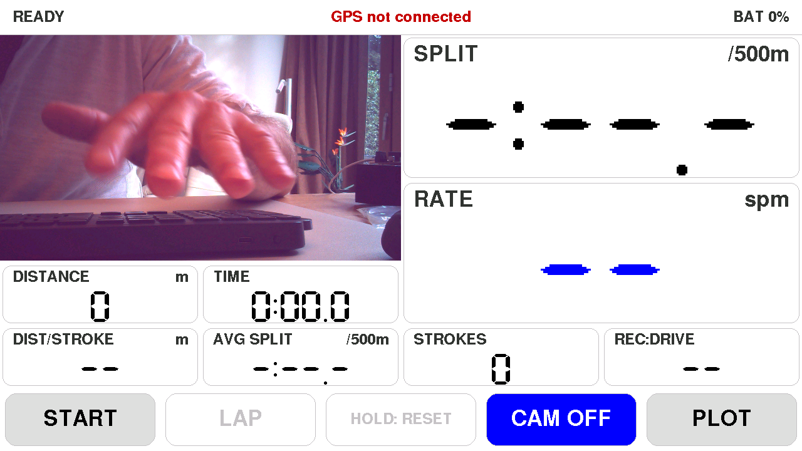
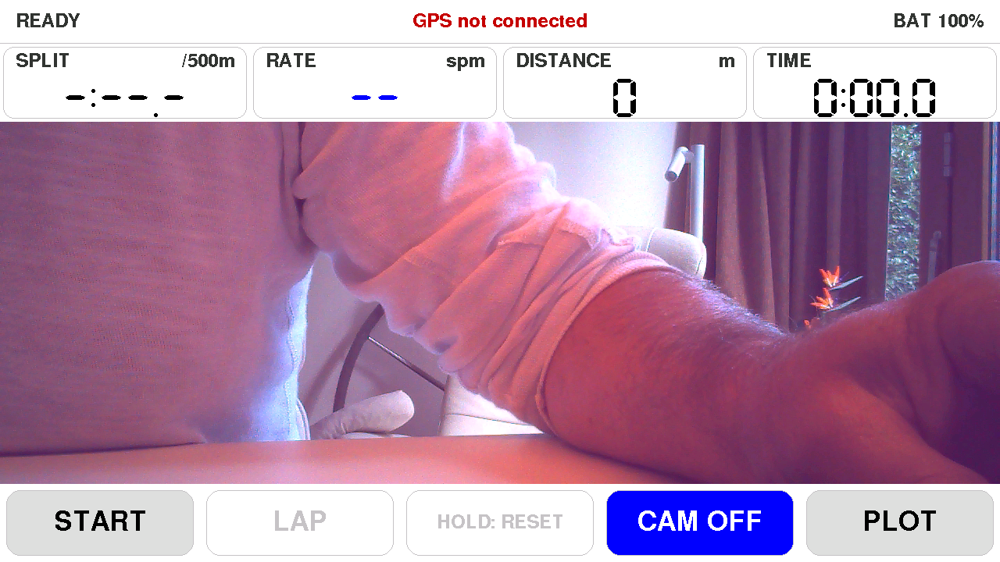

# M5Tab Rowing

A SpeedCoach-style rowing monitor for the M5Stack Tab5 (ESP32-P4). Stroke rate
comes from the built-in BMI270 accelerometer; split, distance and distance per
stroke come from a GPS unit on the Grove port. Runs standalone, logs to microSD.


## Hardware

| Part | Notes |
| --- | --- |
| M5Stack Tab5 | 1280x720 display, BMI270 IMU, microSD slot, battery |
| M5Stack Unit GNSS / GPS v1.1 (ATGM336H-6N, AT6668) | plug into **Port A** (red Grove, G53/G54) |
| microSD card | FAT32 (exFAT is not supported); the `F`/`Y` serial command formats it on the device |
| Waterproof case / phone mount | the Tab5 is not water resistant |

The firmware switches the Grove 5 V output on and turns Port A into a UART. It
scans 115200/9600/38400/57600 baud and both pin orders, so the unit works with
a standard Grove cable. Once found it configures 10 Hz updates (AT6668 /
CASIC commands, with u-blox and MTK fallbacks) and only RMC + GGA sentences.

Mounting: any orientation works. The detector finds the boat's forward axis by
itself (largest horizontal acceleration) and works out which way is forward from
the shape of the stroke, or from GPS once you are moving above 1 m/s. Mount it
rigidly: a wobbly holder adds noise that looks like strokes.

## Building and flashing

PlatformIO with the [pioarduino](https://github.com/pioarduino/platform-espressif32)
platform `55.03.312-1` (Arduino core 3.3.12, ESP-IDF 5.5) and the `m5stack-tab5-p4`
board, which targets the pre-rev3 ESP32-P4 silicon in current Tab5 units. The
camera library (`ESP_Video`) needs Arduino core 3.3.11 or later.

```powershell
$env:PYTHONIOENCODING='utf-8'; $env:PYTHONUTF8='1'   # esptool prints non-cp1252 characters
python -m platformio run -e tab5 -t upload --upload-port COM10
```

Environments:

- `tab5` is the real firmware.
- `tab5_sim` generates synthetic rowing (20 -> 32 -> 20 spm over 2 minutes, device
  tilted 35 degrees) and a synthetic GPS track, so the whole pipeline can be tested
  at a desk. The top bar shows a `SIM` badge.

Windows notes:

- `platformio.ini` sets `core_dir = C:/pio` because the ESP32 Arduino libraries
  nest deeper than Windows' 260-character path limit. Delete that line if long
  paths are enabled or you build on Linux/macOS.

## Using it

Five screens; the right-most bottom button cycles through them.

| Screen | Content |
| --- | --- |
| Main | split /500m, stroke rate, distance, time; distance per stroke, average split, strokes, recovery:drive with a SLOWER / GOOD / QUICKER indicator |
| Map | offline waterway map with your position, heading and track; head-up/north-up toggle and zoom buttons |
| Efficiency | distance per stroke against rate with your best line, efficiency score, ratio/check/bounce gauges and a coaching hint |
| Plot | last 6 s of the forward acceleration with threshold, catch and finish markers, and drive/recovery/check/bounce stats |
| Settings | threshold K and floor, minima threshold, raw IMU logging, GPS+IMU fusion, rec:drive target shift, camera mirror image, day/night theme, flip display, brightness |

Bottom buttons: **START** starts a session, **LAP** splits a lap, **hold STOP**
ends the session, **hold RESET** clears it. Stroke rate and split show before
START; distance, time and logging run only during a session.

**PIP** (Main screen only) cycles the picture-in-picture pane through **OFF**,
**CAMERA** and **MAP**. Tap the pane to switch between picture-in-picture (pane
top left, split and rate beside it) and full width (split, rate, distance and
time in a strip above it).

- **CAMERA** shows the built-in camera, which looks past the rower towards the
  bow, i.e. where the boat is going. It runs only while shown, at about 20 fps,
  and stops on the other screens. The image is mirrored by default, like a
  rear-view mirror; turn that off in Settings.
- **MAP** shows the same offline waterway map as the Map screen.




### Map screen

The Map screen draws an offline vector map of the waterways around you, built
from OpenStreetMap data (see below). Water areas and canals are blue, your boat
is the yellow triangle, and the current session's track trails behind it in
orange. The scale bar is bottom-left and the OpenStreetMap credit bottom-right.

- The **HEAD UP** / **NORTH UP** button rotates the map to your heading or keeps
  north up (a red north arrow shows in head-up mode).
- The **+** / **-** buttons bottom-right zoom in and out.

The map follows your GPS fix and automatically switches to whichever uploaded
map file covers your position, so you can keep several areas on the card.


### Rhythm and efficiency

**REC:DRIVE** is recovery time divided by drive time, averaged over 5 strokes.
The target follows the stroke rate: about 2.5 at 20 spm, falling to about 1.3
at 34 spm (a long, calm recovery at low rates; at race pace the recovery has to
shrink). Within 15% of the target the tile is green with **GOOD**; below it,
orange **SLOWER** means you are rushing the slide; above it, **QUICKER** means
the recovery drags. Red means more than 30% off. If your coach wants a
different rhythm, shift the whole target up or down in Settings.

The **Efficiency** screen compares each stroke with your own best in this
session at the same rate:

- The chart plots metres per stroke against stroke rate. The blue line is your
  best (3-stroke average, so a single GPS jump does not count), the big dot is
  now. The thin curves are lines of equal split: getting the same split at a
  lower rate means longer strokes, so aim to push your best line up and right.
- **EFFICIENCY** is your current distance per stroke as a percentage of that best
  (it needs about 5 strokes at a rate before it scores).
- The gauges show recovery:drive against its target band, and check and bounce
  against your usual values in this session (lower is better).
- The line above the buttons gives one hint, in order of priority: rhythm,
  then a rough slide (check), then stroke length.

Wind and current change distance per stroke, so the best line is per session:
it clears when you start a new session, and **hold CLEAR** clears it after you
turn into the wind.


## Session logs

Each session writes `/rowing/S####_*.csv` on the SD card:

| File | One row per | Contents |
| --- | --- | --- |
| `_strokes.csv` | stroke | rate, drive/recovery time, split, speed, distance per stroke, distance, catch depth, check, bounce, position |
| `_seconds.csv` | second | UTC, position, speed, split, distance, rate, HDOP, satellites, battery |
| `_laps.csv` | lap | lap time, distance, average split and rate, strokes |
| `_imu.csv` | IMU sample (100 Hz) | raw accelerometer and gyro, filtered surge, threshold, catch flag, GPS speed (only with raw logging on) |

## Serial tools

Open the port with DTR/RTS held low; otherwise opening it resets the ESP32-P4.
The scripts in `tools/` do this.

```powershell
python tools\serial_log.py COM10 60                       # print status every 5 s and every stroke
python tools\serial_log.py COM10 60 log.txt --send "3:G,40:L,70:X"   # start, lap, stop at those seconds
python tools\send.py COM10 N                              # N next screen, G start, L lap, X stop, R reset
python tools\send.py COM10 C                              # C cycle PIP off/camera/map, V picture-in-picture/full width
python tools\send.py COM10 H                              # H map head-up/north-up; +/- zoom the map
python tools\send.py COM10 M                              # M open the Maps screen (download maps)
python tools\send.py COM10 'T 640 360'                    # tap at x y; 'P x y' hold, 'Z x0 y0 x1 y1' drag
python tools\send.py COM10 'W MyNetwork|MyPassword'       # join Wi-Fi and remember it; 'W ' reconnects
python tools\serial_log.py COM10 5 --send "1:D"           # list SD session files and /map files with their first lines
python tools\serial_log.py COM10 40 --send "1:F,2:Y"      # erase the SD card: one FAT32 partition, then restart
python tools\screenshot.py COM10 shots\main.png           # needs Pillow
```

## Offline maps

Maps are vector `.rmap` files drawn on the device, not raster tiles, so they are
small and fast (a 6 x 6 km city area is about 300 KB). On the water no network is
needed: the map that contains your GPS position is loaded automatically.

### Downloading maps on the Tab5

Tap **MAPS** on the Map screen (between sessions). Wi-Fi switches on while this
screen is open and off again when you leave it.

- **LIBRARY**: well-known rowing waters (Bosbaan, Willem-Alexander Baan, Amstel,
  Henley, Tideway, Rotsee, Bled, ...). Tap DOWNLOAD; UPDATE fetches a fresh copy.
- **DRAW AREA**: an OpenStreetMap background centred on your position. Drag to
  pan, +/- to zoom, tap SELECT AREA and drag a rectangle over the water you row
  on (up to 8 x 8 km), then DOWNLOAD AREA.
- **ON CARD**: the maps on the SD card with their size; DELETE, then CONFIRM.

A download takes 30-60 s, mostly waiting for the Overpass map server; the header
shows progress. The Tab5 then converts the data itself (about 2 s) and shows the
new map. Downloads are refused while a session is recording. If the server is
busy, try again a minute later.


**Wi-Fi setup.** The first time, tap **WIFI SETUP** (later: hold the WIFI
button to choose another network). The Tab5 opens its own network
`TabRowing-XXXX` and shows a QR code; scan it with your phone, and a page opens
where you pick your home network (2.4 GHz) and enter its password. The Tab5
remembers it. Over USB you can also send `python tools\send.py COM10 'W MyNetwork|MyPassword'`
(single quotes in PowerShell).


Map data is fetched over plain HTTP from overpass-api.de (that server only
accepts TLS 1.3, which the ESP32 TLS stack in this core does not support); the
background map uses HTTPS from tile.openstreetmap.org without certificate
checks. Only public map data is transferred.

### Building maps on a PC

Alternatively build a map with `make_map.py`
(needs `requests`, `osm2geojson` and `shapely`), then upload it to the card.

```powershell
pip install requests osm2geojson shapely
python tools\make_map.py --center 52.3245,4.8360 --radius-km 3 --name "Bosbaan" --out maps\bosbaan.rmap
python tools\send_file.py COM10 maps\bosbaan.rmap /map/bosbaan.rmap
```

`make_map.py` queries the Overpass API for water, bridges, locks, weirs, piers
and rowing clubs, clips and simplifies them, and writes the `.rmap` plus a
`.png` preview so you can check it before uploading. `send_file.py` streams the
file to `/map/` on the SD card in small acked chunks and verifies a CRC; the
firmware picks up the new map without a reboot. Map data is
(c) OpenStreetMap contributors, [ODbL](https://www.openstreetmap.org/copyright).

## On-water validation against an NK SpeedCoach

1. Mount the Tab5 next to the SpeedCoach. Check **Raw IMU logging** is ON in Settings.
2. Start both at roughly the same time. Row a mix: steady state at 18-22 spm,
   a few minutes at 24-28, some starts and bursts at 30+, and some easy paddling.
3. Export the session from NK LiNK Logbook as CSV and copy the SD card files.
4. Compare per stroke. The time offset between the devices is found automatically:

   ```powershell
   python tools\compare_nk.py S0007_strokes.csv nk_export.csv
   ```

   It reports bias, mean absolute error and the 95% range for stroke rate,
   split and distance per stroke, the total distance, and lists strokes whose
   rate differs by 2 spm or more.

5. If strokes are missed or doubled, replay the raw log with other settings and
   copy the best values to the Settings screen:

   ```powershell
   python tools\replay.py S0007_imu.csv --sweep            # grid of K / floor / minima
   python tools\replay.py S0007_imu.csv --k 1.2 --floor 0.08
   python tools\replay.py S0007_imu.csv --plot 60 90       # needs matplotlib
   ```

   `replay.py` is a line-by-line port of `src/stroke_detector.cpp`; keep them in
   sync when changing the detector.

Tuning hints:

- **Missed strokes** (smooth or shallow catches, fixed-seat rowing): lower the
  floor to 0.08 g and K to about 1.2.
- **Double counts** (rough water, a big bounce at the finish): raise K, or turn on
  the minima threshold, which follows the depth of your recent catches.
- Drive and recovery look swapped on the Plot screen during the first strokes
  without GPS: the forward direction is still being learned from the stroke shape.
  It settles within a few strokes, and GPS overrides it after about 10 s of rowing.

## How it works

- **Stroke rate**: gravity is tracked with a slow average and removed. The
  remaining acceleration is band-passed (0.1-3 Hz) and projected onto the
  horizontal axis with the most motion. The catch is the sharp deceleration dip:
  a catch is the midpoint of where the signal crosses an adaptive threshold
  (K x RMS, or 0.6 x recent catch depth) on the way down and up again. Rate is
  the average of the last 3 stroke intervals.
- **Forward direction**: the catch dip is short and deep, the drive is long and
  shallow, so the forward acceleration has negative skew. When GPS is moving, the
  integrated acceleration is correlated with the GPS speed fluctuations, which
  settles the direction even for smooth rowers.
- **Split and distance per stroke**: GPS speed averaged over each stroke cycle;
  distance accumulates GPS positions with a 3 m minimum step so it does not drift
  while stationary. Optionally a complementary filter blends GPS speed with the
  integrated accelerometer for distance per stroke.
- **Check / bounce**: check is how unevenly the boat decelerates during the
  recovery (scatter around a straight line, in mg); bounce is the vertical
  acceleration RMS.
